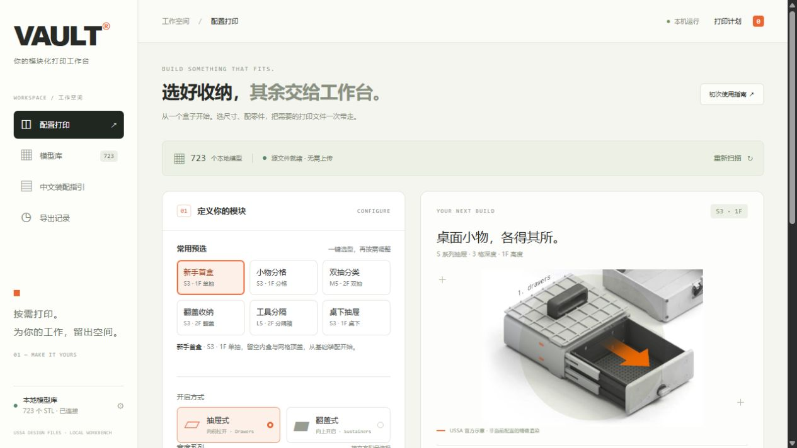

# VAULT 中文打印工作台

在中文界面中选择 VAULT 抽屉或翻盖箱的尺寸与配件，自动匹配本地 STL，整理为 ZIP 和打印清单。



## 功能

- 按系列、深度、外壳高度、内抽组合和选配件生成打印计划。
- 新手可用6个中文常用预选一键填好配置，并继续按需调整。
- 中文搜索模型，支持独立零件补打和 STL 旋转预览。
- 合并相同文件的打印份数，一份 STL 可以包含一对或一套零件。
- 导出原始 STL、中文打印清单、五金参考清单和 SHA-256 校验记录。
- 提供官方手册的本地阅读入口、配套规则依据和导出历史。
- 仅在本机运行；Python 标准库实现，无需安装额外依赖或填写 API 密钥。

## 开始使用

需要 Python 3.10 或更新版本，以及你自己的 VAULT 模型资料库。

Windows 下双击 **启动VAULT工作台.cmd**，浏览器会自动打开工作台。也可以从项目目录运行：

```powershell
python server.py --open --root "D:\你的VAULT模型库"
```

模型库根目录应包含 `01. DRAWERS`、`02. SUSTAINERS`、`03. MODIFICATIONS` 等原始目录。可以在界面左下方修改路径并重新扫描。

默认地址为 `http://127.0.0.1:8765`。端口占用时会尝试后续端口；再次运行启动器可打开当前有效地址。

本仓库包含工作台代码、界面资源与说明文档。完整 STL 模型库和官方 PDF 需在本机单独准备。

## 使用流程

1. 选择抽屉式或翻盖式，再选择型号和配置。
2. 查看零件、整份 STL 打印次数与五金依据。
3. 加入打印计划；也可从模型库加入独立补打文件。
4. 整理并打包 ZIP，在导出记录中下载或打开文件夹。

详细说明见 [使用说明](使用说明.md)。配套依据见 [规则核对记录](docs/assembly-evidence.md)。

## 支持范围

按本地 261020 版资料库核对，索引共 723 个 STL。自动套件支持 S/M/L 抽屉和本地存在的 S/M/L/XL 翻盖箱版本。

XL 抽屉与 L²/XL² 完整配方仍待核对，可通过模型库独立补打。工作台不自动切片或生成 G-code；配套检查尚未经过实物打印装配验证。

## 开发验证

```powershell
python -m unittest discover -s tests -v
```

真实资料库相关测试需要 `vault/catalog.py` 中配置的资料路径存在；未连接时会跳过。导出契约测试使用临时目录运行。

运行状态、导出包和临时文件分别保存在 `runtime/`、`exports/`、`tmp/`，已由 Git 忽略。

本项目为个人本地工具，非 USSA 官方软件。
