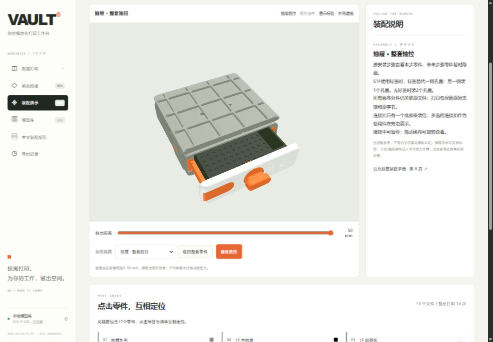
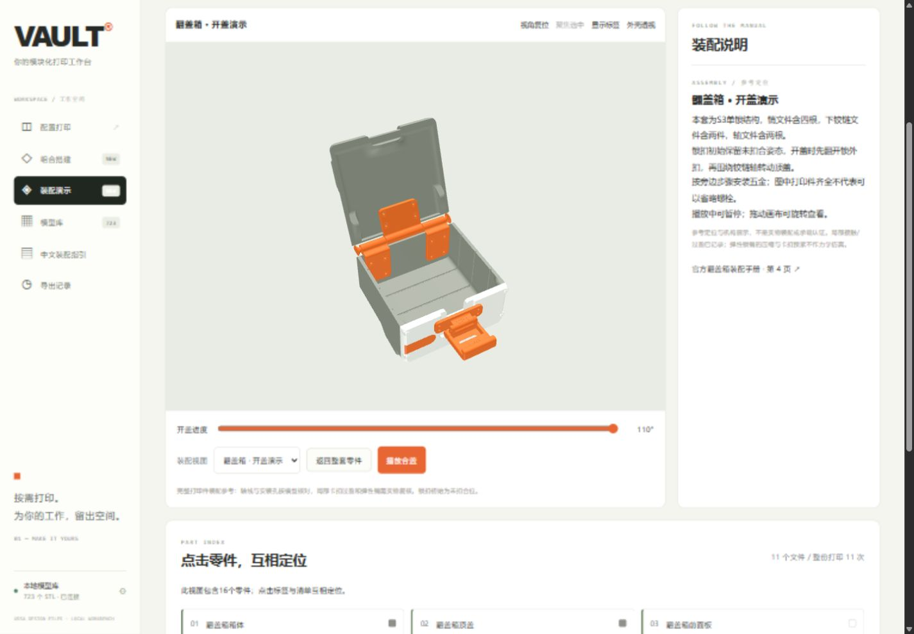
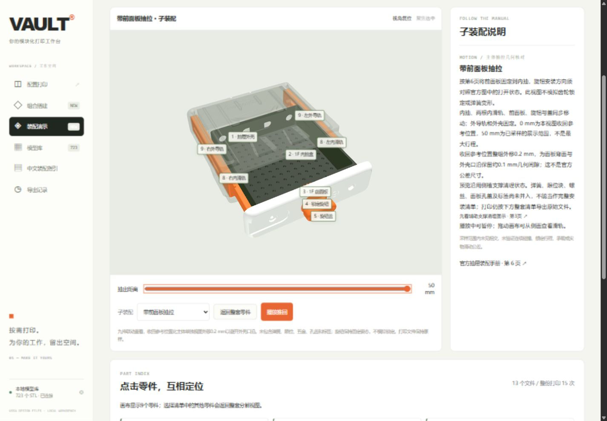
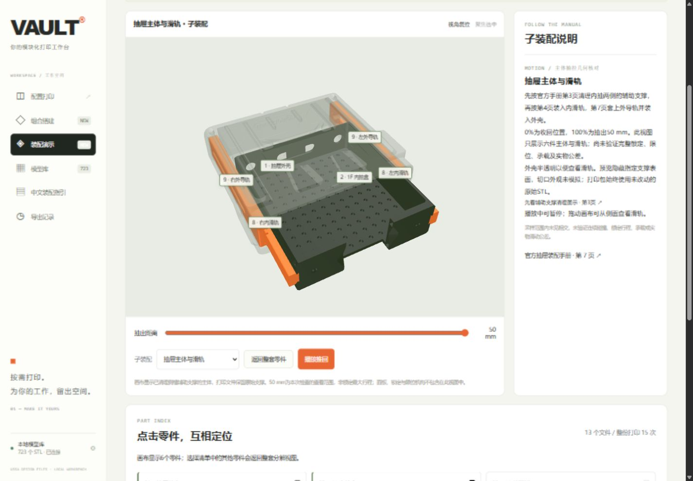
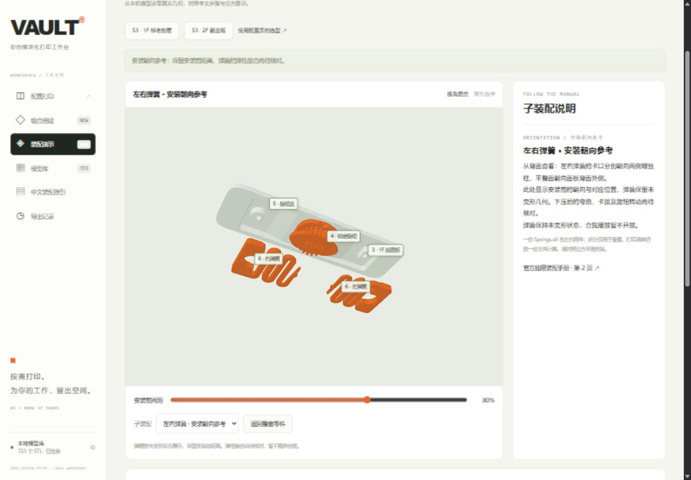
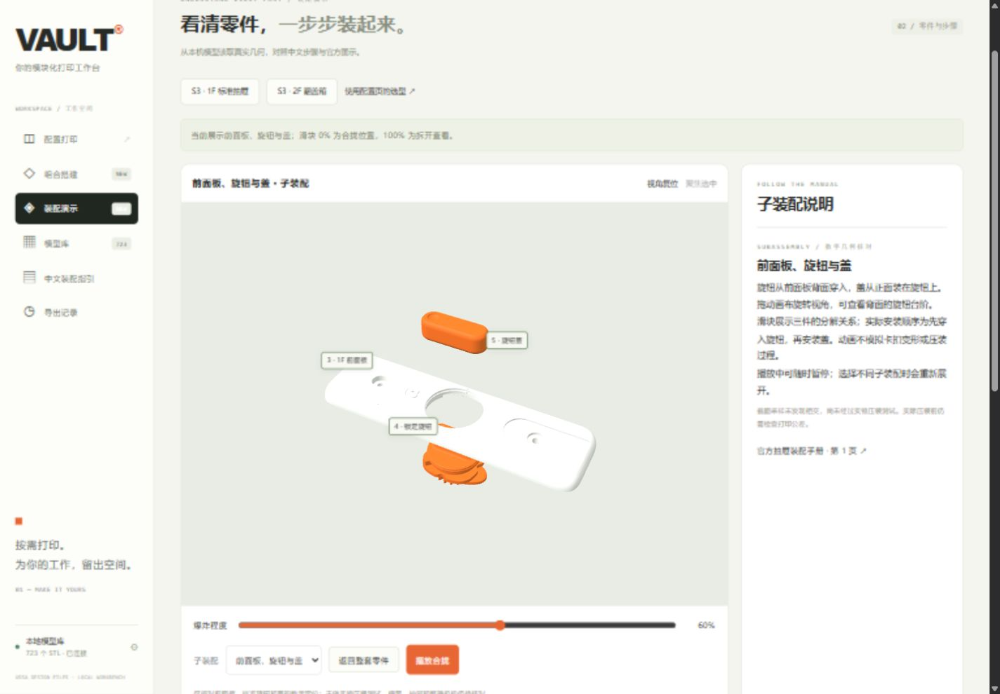
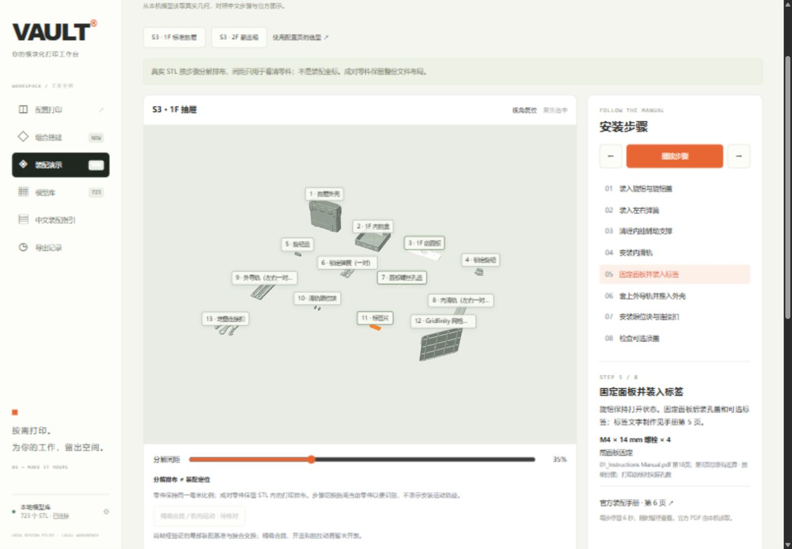
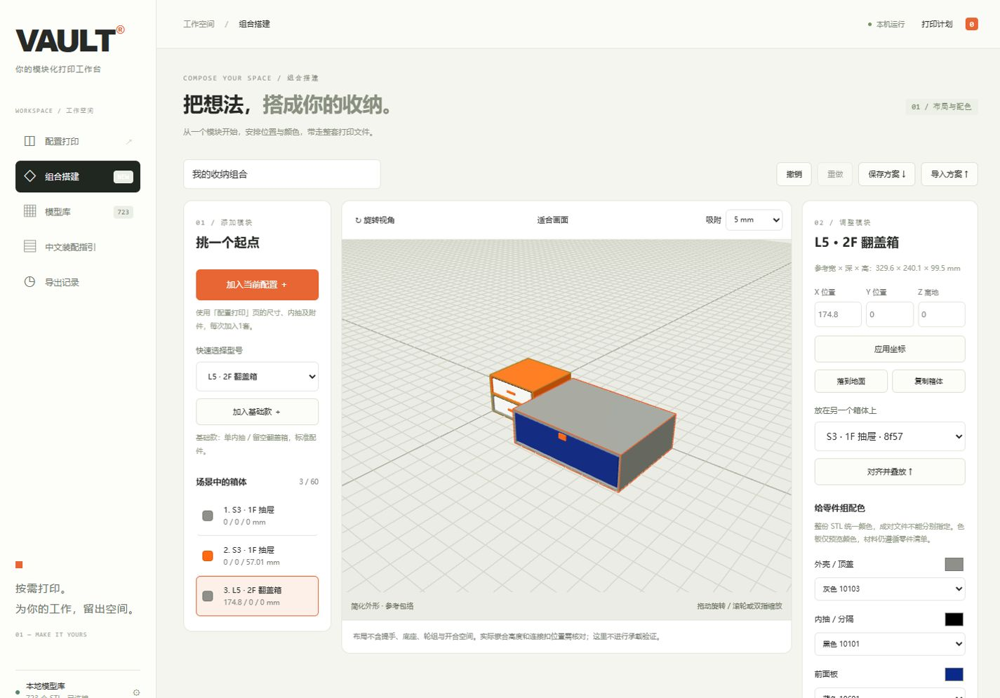
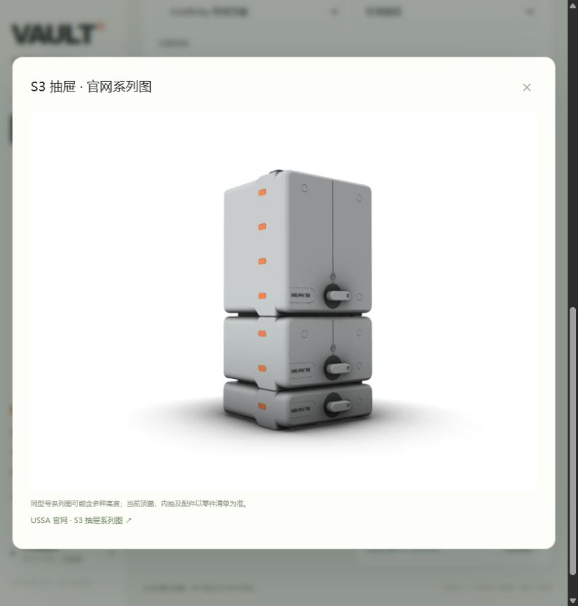

# VAULT 中文打印工作台

在中文界面中选择 VAULT 抽屉或翻盖箱的尺寸与配件，自动匹配本地 STL，整理为 ZIP 和打印清单。


## 功能

- 装配演示：S3 1F 抽屉与 S3 2F 翻盖箱的真实 STL 分解预览、零件点选、步骤播放、五金和手册页码联动。
- 三维组合搭建：拖动与边缘吸附、位置输入、复制、撤销重做、保存与导入方案。
- 参考包络碰撞与悬空检查；30个拓竹 PLA Basic 色号及自定义配色，按颜色分别生成打印任务和 ZIP。
- 按系列、深度、外壳高度、内抽组合和选配件生成打印计划。
- 新手可用6个中文常用预选一键填好配置，并继续按需调整。
- 按型号切换40张 USSA 官网原始系列图，支持查看大图和追溯来源；图片保存在本地，可离线显示。
- 中文搜索模型，支持独立零件补打和 STL 旋转预览。
- 合并相同文件的打印份数，一份 STL 可以包含一对或一套零件。
- 导出原始 STL、中文打印清单、五金参考清单和 SHA-256 校验记录。
- 提供官方手册的本地阅读入口、配套规则依据和导出历史。
- 仅在本机运行；Python 标准库实现，无需安装额外依赖或填写 API 密钥。

## 开始使用

版本更新请查看 [GitHub Releases](https://github.com/zhangyunupupup/vault-workbench/releases) 或 [更新记录](CHANGELOG.md)。

**Windows免安装版**：从[最新Release](https://github.com/zhangyunupupup/vault-workbench/releases/latest)下载 `VAULT-Workbench-2.1.0-windows-x64.zip`，完整解压到可写目录后双击「启动VAULT工作台.cmd」。内置Python运行环境，支持Windows 10/11 x64；仍需自己的VAULT资料库。不要在ZIP内部直接运行。

**手机先体验**：[打开「VAULT 随手搭」](https://zhangyunupupup.github.io/vault-workbench/assets/demo/index.html)。无需模型库，可做两套基准的简化布局、配色与方案JSON操作；首次联网并显示「离线已就绪」后可离线再访。iPhone可通过Safari分享菜单添加到主屏幕，其他浏览器可使用安装菜单。手机保存的JSON在桌面「组合搭建」导入后重新核对，再导出真实STL。

源码版需要 Python 3.10 或更新版本，以及你自己的 VAULT 模型资料库。

Windows 下双击 **启动VAULT工作台.cmd**，浏览器会自动打开工作台。也可以从项目目录运行：

```powershell
python server.py --open --root "D:\你的VAULT模型库"
```

模型库根目录应包含 `01. DRAWERS`、`02. SUSTAINERS`、`03. MODIFICATIONS` 等原始目录。可以在界面左下方修改路径并重新扫描。

默认地址为 `http://127.0.0.1:8765`。端口占用时会尝试后续端口；再次运行启动器可打开当前有效地址。

本仓库包含工作台代码、界面资源与说明文档。完整 STL 模型库和官方 PDF 需在本机单独准备。

## 使用流程

1. 选择抽屉式或翻盖式，再选择型号和配置。
2. 查看零件、整份 STL 打印次数与五金依据。
3. 加入打印计划；也可从模型库加入独立补打文件。
4. 整理并打包 ZIP，在导出记录中下载或打开文件夹。

详细说明见 [使用说明](使用说明.md)。配套依据见 [规则核对记录](docs/assembly-evidence.md)。

## 支持范围

按本地 261020 版资料库核对，索引共 723 个 STL。自动套件支持 S/M/L 抽屉和本地存在的 S/M/L/XL 翻盖箱版本。

XL 抽屉与 L²/XL² 完整配方仍待核对，可通过模型库独立补打。工作台不自动切片或生成 G-code；配套检查尚未经过实物打印装配验证。

## 开发验证

```powershell
python -m unittest discover -s tests -v
node tests/test_assembly_mesh.mjs
node tests/test_assembly_controls.mjs
node tests/test_assembly_pose.mjs
node tests/test_demo.mjs --fixture
```

真实资料库相关测试需要 `vault/catalog.py` 中配置的资料路径存在；未连接时会跳过。导出契约测试使用临时目录运行。

截面回归测试与开发检查脚本需要可选的 numpy/shapely；未安装时3项截面测试会跳过，工作台运行不受影响。

运行状态、导出包、临时文件和本地发行包分别保存在 `runtime/`、`exports/`、`tmp/`、`dist/`，已由 Git 忽略。发行包通过 `scripts/build_release.py` 白名单构建，官方运行环境版本与许可见[第三方资源](THIRD_PARTY_NOTICES.md)。

本项目为个人本地工具，非 USSA 官方软件。

## 装配演示（v2.0.0）

侧栏打开「装配演示」，选择两个入门示例之一，或从「组合搭建」进入选中箱体的步骤。点击三维标签或下方零件清单可选中零件，「聚焦选中」用于查看小配件。支持分解间距、视角复位、上/下一步及自动播放；官方手册始终从本机读取。

第二期两套基准已覆盖全部所选打印件：**S3 1F抽屉为13文件、14份打印、17个实体；S3 2F翻盖箱为11文件、11份打印、16个实体**。选择「分步安装」可连续播放、暂停/继续或单独切步；未来零件暂时隐藏，面板子装配完成后整体入位。另提供整套分解、抽屉0–50 mm抽拉、翻盖箱先翻开锁扣再开盖的0–110°演示，以及锁扣转轴查看。标签可以隐藏，外壳可以透视。





S1F使用标签时，标签替代一侧孔盖，仅打印1个孔盖；无标签时打印2个。面板固定按实测两孔计2颗M4×14，避免套用宽箱示例数量。定位、接触数值与限制见[完整装配验证记录](docs/complete-assembly-evidence.md)。

新增「带前面板抽拉」：把面板、旋钮与盖接到内抽上，7份文件显示9件，沿用0–50 mm滑块与播放暂停。收回参考位置经口沿检查调整，独立主体和面板视图仍可切换。未包含弹簧、限位、五金、孔盖和标签，旋钮不模拟锁定。详见[面板与主体接合依据](docs/drawer-facade-evidence.md)。



新增「抽屉主体与滑轨」：由4份本地文件显示6件主体，支持0–50 mm抽拉、推回/抽出播放与暂停。外壳半透明，内抽按已清理侧槽支撑的状态预览；打印包仍保留原始支撑。此视图不含完整面板、锁定和限位机构。详见[主体定位与采样依据](docs/drawer-body-evidence.md)。



在 S3 1F 标准抽屉中，可选择「前面板、旋钮与盖」或「标准旋钮与盖」，查看三件/两件的合拢与拆开，支持滑块、播放及暂停/继续。入口仅对已核对哈希的本地文件开放；前面板版本不符时仍保留两件视图。详见[三件定位依据](docs/panel-joint-evidence.md)与[两件定位依据](docs/key-cap-joint-evidence.md)。

新增「左右弹簧·安装朝向参考」：拆开一份文件中的两件弹簧，用背面视角查看平整面、卡口与左右对应关系。保留安装前间距，弹性接合待核对，暂不提供弹簧合拢。详见[弹簧分件与检查依据](docs/spring-orientation-evidence.md)。



**完整视图是参考装配，弹簧含变形示意，开口销、卡扣接触和锁扣预载未作实物/力学验证。** 安装与爆炸动作是关系插值，不能当作无碰撞装入路径或额定行程；其他型号与改装件尚未扩展。原有局部子装配继续保留，文件版本不符时独立降级。详见[验证依据与边界](docs/assembly-preview-evidence.md)。





## 组合搭建（v1.1.0）



进入「组合搭建」，加入当前配置或基础型号，使用移动模式拖动，或输入X/Y/Z后点击「应用坐标」。选择支撑箱体可对齐叠放；保存方案会下载JSON，重新导入会核对本地模型库。每个场景最多60个箱体。

按外壳、内抽、面板与配件配色后，同文件同色合并份数，不同颜色分别建目录。一份STL中的成对零件保持统一颜色。CSV和ZIP均包含颜色，ZIP额外附带组合方案。

预览是简化外形与参考包络，不含提手、底座、轮组和开合空间；同尺寸叠放仍需核对嵌合高度及连接扣。红色碰撞或悬空问题会阻止组合导出，黄色说明未核实条件。两套基准的完整参考装配见上方装配演示，其他规格仍待核对。详见 [搭建数据依据](docs/builder-evidence.md)。

## 随手搭与离线发行（v2.1.0）

随手搭使用原创简化外形，仅开放S3 1F标准单抽屉和S3 2F整盖翻盖箱的布局与配色。支持列表选择、坐标、5 mm拖动吸附、对齐叠放、复制删除、撤销重做、自动保存和JSON导入导出；最多60个箱体。未接入的型号与改装配置会拒绝导入，不会静默改型。

演示使用独立离线缓存，只缓存演示与本地三维依赖，不读取或缓存本地API、STL和PDF。数据保存在当前浏览器，清理网站数据可能删除方案，请用JSON备份。手机不能访问电脑磁盘，桌面服务继续只监听127.0.0.1。


Release同时提供Windows x64便携包、静态演示包和SHA256SUMS校验表。静态演示包可部署到HTTPS子目录，直接用file://打开不支持模块与离线安装。验证范围与构建步骤见[离线发行记录](docs/offline-evidence.md)。

## 型号图片



图片来自 [USSA VAULT 官网](https://www.ussadesign.com/pages/vault)，按开启方式、宽度系列和深度编号匹配。系列图可能同时展示多种高度；具体高度、内抽、顶盖及配件以打印清单为准。双列等尚未接入专属图的型号保留带说明的装配示意。

图片属于 USSA 官方展示素材，未采用官网的 AI 辅助 studio 展示图。每张图片的原始地址与 SHA-256 见 [图片来源记录](web/assets/official-images.json)。
