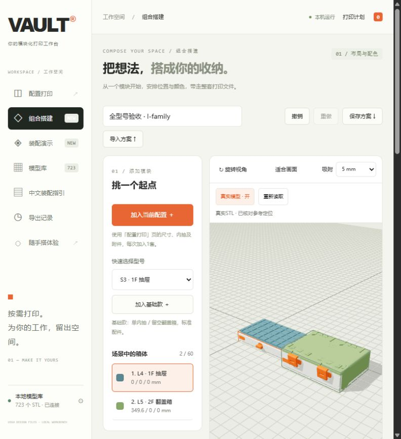
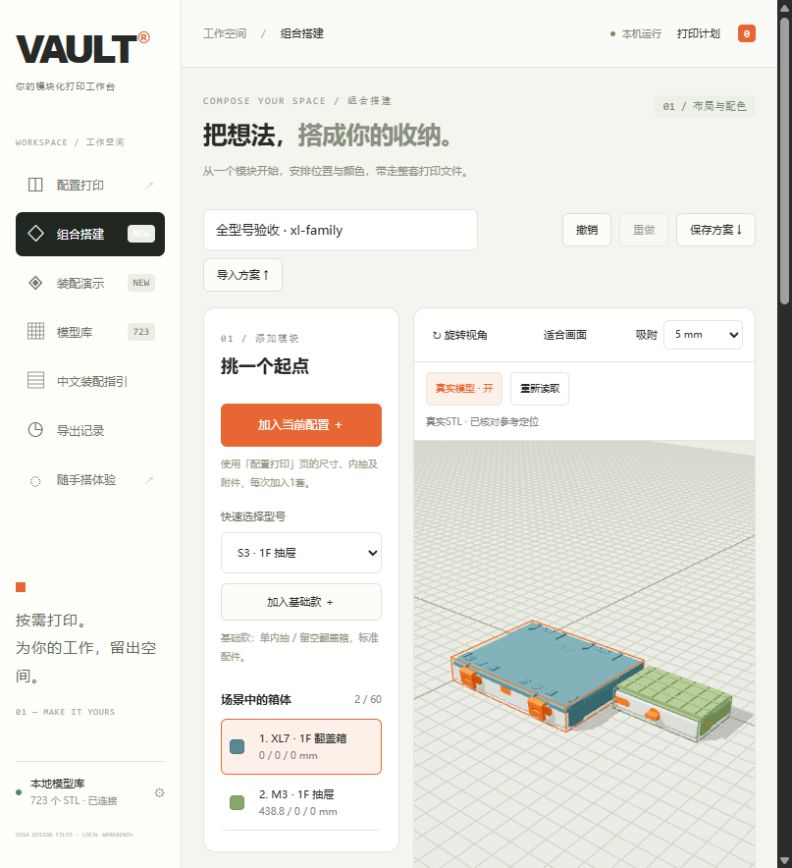
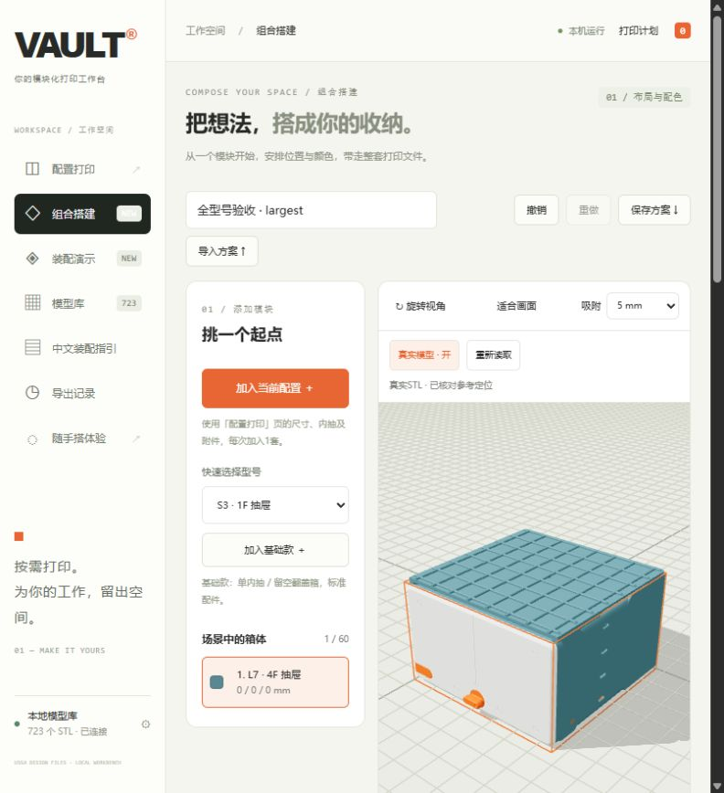
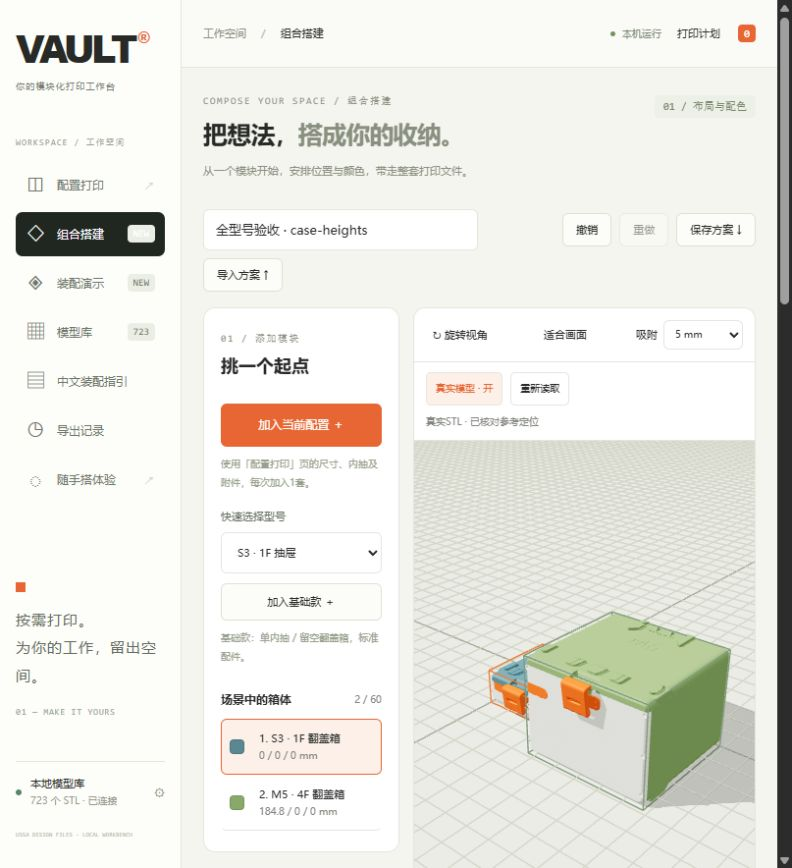

# 全部可选型号的真实外观预览

日期：2026-10-28。适用于本地261020文件库。此轮扩展组合搭建的外观参考，原两套基准的安装动画保持原有范围。

## 覆盖范围

| 类别 | 家族 | 深度编号 | 高度 | 箱体版本数 |
|---|---|---|---|---:|
| 抽屉 | S/M/L | 3–7 | 1/2/4F | 45 |
| 翻盖箱 | S/M | 3–7 | 1/2/4F | 30 |
| 翻盖箱 | L | 3–7 | 1/2/4F，空箱/网格分隔/封闭分隔 | 45 |
| 翻盖箱 | XL | 3–7 | 1F，空箱/网格分隔/封闭分隔 | 15 |

共95组尺寸与高度、135个基础版本，涉及266份唯一STL。支持标签开关、抽屉网格顶盖/无顶盖、连接扣数量和多内抽。多内抽的齿条未建立安装定位，界面明确提示预览省略，打印配方仍完整保留。隐藏旋钮、其他顶盖、分体翻盖、独立内部分隔及外部改装选配保持简化回退。XL抽屉和双列箱体的完整配方仍不开放。

## 定位依据

[目录生成器](../scripts/build_layout_catalog.py)读取本地文件的完整三角形，记录SHA-256、面数、实际边界、刚体矩阵和连通体数量；输出[定位元数据](../vault/layout_data.json)，不输出网格、PDF或本地绝对路径。开发测量使用NumPy/Shapely；工作台运行仍只需Python标准库。

- 每个箱体、内抽、面板和顶盖核对实际宽度、深度及朝向。撤销打印时的倾斜后保持原始尺寸，不向名义参考包络拉伸。M5 1F翻盖箱深度比名义值多约0.097 mm；L7整盖存在约0.336 mm的额外宽度，均保留原始几何。
- 抽屉根据共同滑槽、旋钮中心、面板后平面及各高度的独立孔位建立参考定位。内抽支撑清理仅用于预览，逐文件记录清理区域和移除面数；导出保留原文件字节。多内抽逐层增加48 mm/F，成对滑轨、弹簧按整份文件的打印份数完整展开。
- 九种S/M/L抽屉面板截面表明：S 1F有2处孔位，S 2/4F和M/L 1F有4处，M/L 2/4F有6处。每个标签恰好替代一个孔盖；孔盖与M4×14螺栓配方据此修正。
- 翻盖箱按面板独立锁座孔型定位；1F锁座比2/4F按高度平移的结果高6 mm，1F外扣还使用不同的孔轴偏置。S/M单锁，L/XL双锁；锁销文件中的四根销不重复计为四份打印。
- 顶盖采用实际承接平面定位，不能把最低的前缘锁钩当成承接面。封闭分隔箱体的局部凸起进入盖内，不抬高整块顶盖。
- 按结构家族与高度测量箱体后部下铰链孔和顶盖上铰链孔，用四孔阵列及轴线选择刚体方向。S/M一件上铰链，L/XL一对。轴从左右穿入，按头部所在端识别朝向。结构家族的定位沿同族深度复用，尚未逐姿态做连续碰撞或实物装配验证。
- 目录保留铰链孔轴残差。最大约0.12501 mm，来自S 1F箱体22.75 mm孔距与下铰链23 mm孔距的差异：按中心对齐原件，每端保留0.125 mm偏移，未缩放消除差异。此记录不构成螺栓或实物公差认证。
- 前端从源坐标映射到竖直轴后再作180°刚体旋转，保持左右手性和文字方向。外壳后下左角锚定布局原点；所有矩阵行正交且行列式为+1。

## 加载与边界

新增独立的组合预览接口，最大支持320万面完整二进制STL；原安装动画的80万面/40 MiB限制不变。大文件在Worker中合并完全相同的顶点，保留剩余全部三角形、顺序、绕向和归零后坐标；不抽面。平面着色使用三角面的法线。加载取消会终止Worker，文件哈希或支撑面数不符则回退并说明原因。

最多缓存两套配置及800万面共享几何，整个场景最多显示2000万面。复制实例共享几何，配色与位置独立。切换选择时可淘汰低优先级缓存，为新选中的大模型腾出空间。备用连接扣不重复安装。离开页面、关闭真实模式或重新扫描会释放缓存。

真实外观继续使用原参考包络检查布局。突出件、实际开合空间、堆叠嵌合和承载未据此认证；同族参考定位不能被当作所有型号已经完成安装动画。静态手机演示不加载本地STL，公开仓库及发行包不包含模型库和官方PDF。

## 验证记录

- 75项Python检查通过，包含所有135个基础版本的源文件版本/实体/份数一致性，九类面板孔盖和螺栓数量，多内抽、双锁及成对铰链，旧装配范围与大小上限，版本不符回退、目录重载、非刚体/镜像拒绝，本机接口令牌与文件修订检查，以及独立便携运行环境验证。
- 6组Node检查通过。新增检查覆盖完整三角形的索引等价性、支撑清理面数、非法坐标、Worker的传输/终止/取消/错误处理、重复份数组合实体、选中优先缓存淘汰及倾斜打印模型的真实顶点锚定。
- 12组完整本地模型实际加载通过：M3 1F、S4 4F、M6 2F、L7 4F、L4 1F抽屉；S3 1F、M5 4F、L3 1F、L5 2F、L7 4F封闭分隔、XL7 1F封闭分隔翻盖箱；以及M3 4F的2+1+1F多内抽。最大抽屉保留7,169,749个源打印实体面，预览支撑清理与共享几何后缓存7,128,837面。
- 浏览器确认用户原场景3/3真实加载，以及L4抽屉/L5双锁翻盖箱、XL7/M3、L7 4F大抽屉、S3 1F/M5 4F翻盖箱的显示、取景与真实/简化切换。控制台无警告或错误。
- 验证前下载用户3箱体方案；完成后导入备份、刷新并再次下载。两份JSON逐字段完全一致，未改变用户配置、颜色或坐标。截图使用独立测试场景，不替换用户方案。

