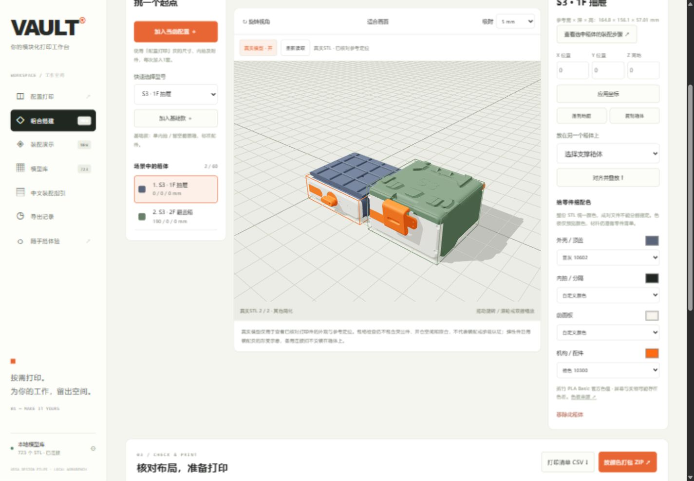
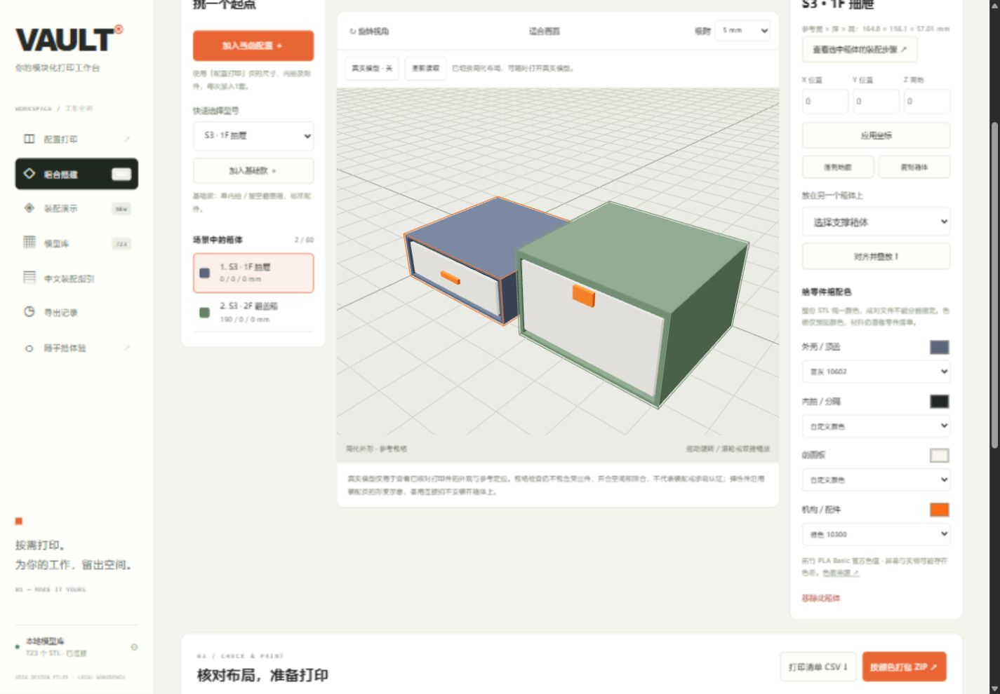

# 组合搭建真实模型验收

日期：2026-10-28。使用已核对的两套基准真实打印件与定位元数据，提高组合搭建的外观还原度；不新增装配定位家族或改变布局检查。

## 几何与定位

- S3 1F标准单抽屉默认加载17个安装实体，S3 2F标准整盖翻盖箱加载16个，复用完整装配目录、SHA-256、完整三角形连通体校验和支撑清理。源STL和打印导出不改变。
- 装配画布坐标为 `[X,Z,-Y]`，绕竖轴旋转180°得到 `[-X,Z,Y]`，再把外壳后下左角对齐当前布局原点。保持手性、文字和左右零件方向，不用非均匀缩放改变模型尺寸。
- 按实际本地文件核对，抽屉外壳宽/高/深为164.802/57.009/146.100 mm，翻盖箱外壳为164.806/84.802/146.100 mm。已有参考包络深度156.1 mm包含外壳之外的名义外观尺寸，不能把单个外壳拉伸到这个深度。模型的突出部分仍按真实位置显示在包络外。
- 弹簧压缩示意、未扣紧锁扣和局部接触限制沿用[完整装配记录](complete-assembly-evidence.md)。连接扣多选的备用件不重复安在箱体上。

## 资源、状态与回退

桌面独立加载器按配置建立模板；同配置复制共用几何，各自按配色组生成材质。位置变动只改变实例变换，配色变化不重复读取文件。不在手机静态包中引入真实模型模块或API依赖。

最多保留2套配置模板、500万面；场景最多显示600万面（按完整打印实体估算，支撑清理后实际面数更少），选中箱体优先。超限或未核对的箱体继续使用简化外形；源版本不符、缺失或读取失败时不展示不完整网格。同一配置失败不会在每个复制件上重复请求。

重新读取、离开页面或重扫资料库时清空缓存并取消旧请求。过期请求不能重新写回画布。几何由缓存统一拥有；重新渲染与删除实例只释放其材质，避免误删其他复制箱体使用的几何。关闭真实模式释放缓存，WebGL失败后仍保留表单与方案操作。

## 自动检查

`node tests/test_builder_detail.mjs` 检查坐标/锚点、复制共享几何和独立颜色、移动后的世界位置、重绘与缓存释放、文件变更、缓存复用、选择优先、预算、取消及失败回退。取景在三种宽高比下核对所有包围盒角点位于画面内。

`node tests/test_builder_detail.mjs --local` 还需生成本地模型fixture；实际读取24份文件，验证两套17/16件完整安装网格及外壳实际尺寸，源数组不被拉伸。此fixture只在本机tmp中保存，不发布源路径或模型。

浏览器已确认两套真实外观、蓝灰配色、20 mm坐标修改与撤销、复制后3/3真实显示、再复制后3/4按预算混合显示，以及真实/简化开关。未支持的L5 2F翻盖箱仍为简化。390/1440像素无横向溢出，控制台无错误；临时视口覆盖恢复。验证前已下载备份原3箱体布局，验证后恢复原方案。

67项Python与5组Node检查通过，24份真实文件的额外定位检查通过。恢复后再次下载方案，与原备份JSON逐字段完全一致；未改变用户已有的型号、位置、颜色或选配。

## 边界

新增的是高还原外观。布局碰撞仍按已有参考包络计算，不自动考虑突出件、铰链、打开空间、连接扣或实物嵌合。不能把画面中看似接合、阴影或未报错当作装配公差、受力或承载认证。其余规格和改装需要逐族核对后再开放。
