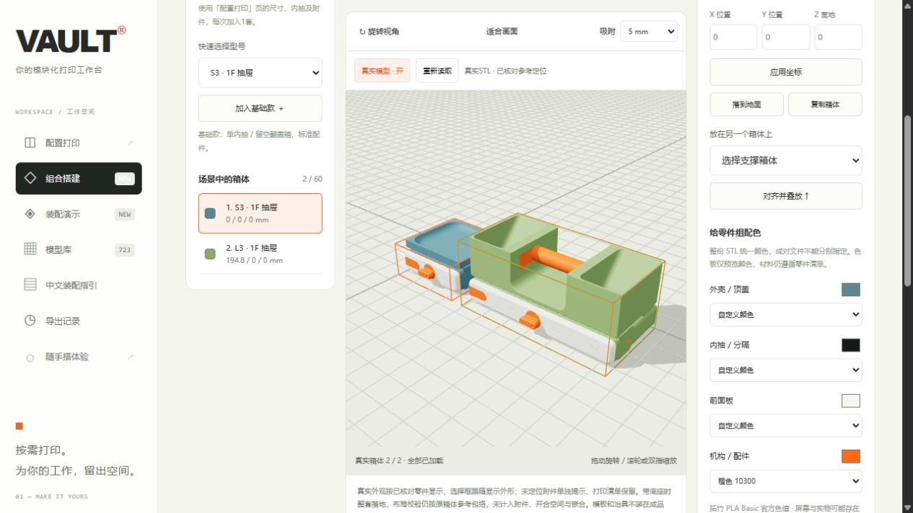
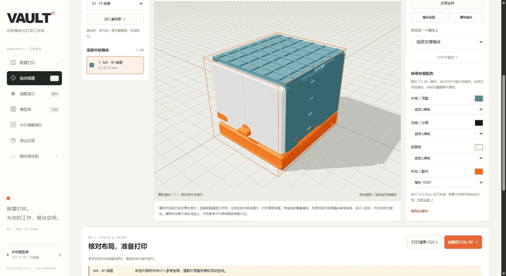
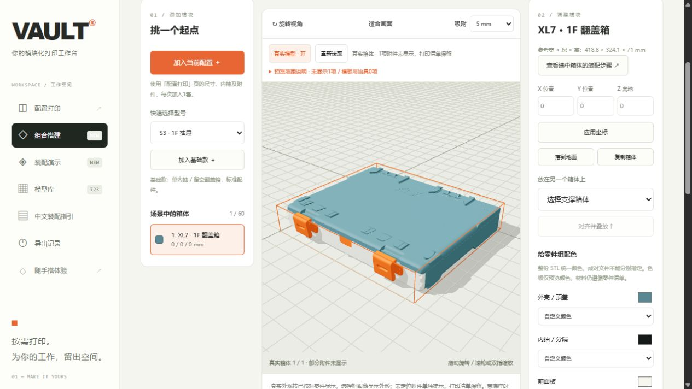
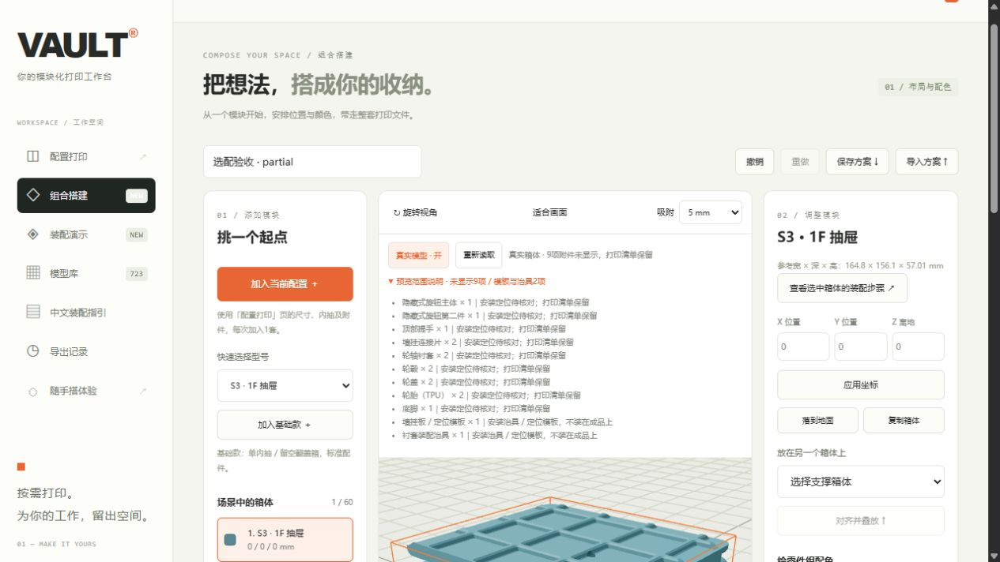
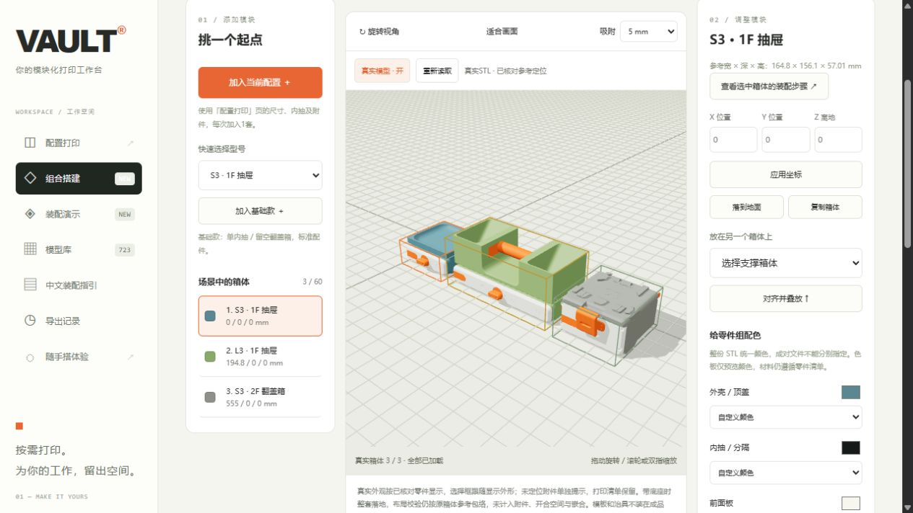

# 选配真实外观与局部回退

日期：2026-10-28，适用261020本地模型库。此轮继续补充组合搭建中原先触发整箱简化的选配，安装动画范围保持原有两套基准。

## 已定位

- S/M/L的平面、托盘和桌下安装顶盖，以及L的承重顶盖。
- L承重顶盖的横向握把和两端插片，按实际槽、轴和插片定位销分别核对。
- 抽屉完整Gridfinity底板，包括当前配方可选的单/双提手版本；S/M/L翻盖箱完整底板，以及XL3/4/5完整底板。
- S/M/L/XL完整底座与当前可选的分体底座两半。
- S/M/L/XL深度6/7的分体翻盖两半。

新增152份唯一文件的哈希、面数、尺寸与刚体定位，存入[选配元数据](../vault/layout_options.json)；[生成器](../scripts/build_layout_options.py)使用开发依赖NumPy/Shapely，本地工作台仍只用Python标准库。元数据不包含网格、PDF和本地绝对路径。

## 几何依据

替换顶盖撤销打印倾角后，核对实际宽度和底部连接结构：最低连接垫与其上方约4.8 mm的宽接触平面与网格顶盖一致。按实际最低点对齐既有接口，不按外观高度拉伸模型；托盘边和承重箱室保持源文件高度。

Gridfinity底板保持原打印尺寸；抽屉以独立内抽的3 mm内底面为基准，翻盖箱以9.8 mm内底面为基准。每个内抽独立叠加48 mm/F，重复文件按打印份数实例化。不同提手版本保持各自原几何。尚未核对XL6/7分片底板的接合位置，未套用完整底板的摆法。

底座撤销S/M、L、XL各自的打印朝向，按主要向上接触平面对齐箱底；不同文件的归零原点独立测量。分体底座及分体翻盖沿实际两半深度拼接，而非强制等分。分体翻盖依据大面积顶面与承接面的15 mm关系建立高度，保留前缘锁钩和后部铰链结构。

承重顶盖握把槽通过曲面法线寻找轴线，再用实际曲面顶点拟合圆；插片按其背面与顶盖内壁贴合。另在五个深度版本分别核对插片销与孔的一个横截面，孔内包含销截面，边缘间距约0.47–0.57 mm。此采样用于避免错轴和反向，不是全行程碰撞或实物压装认证。

所有姿态为行列式+1的刚体旋转和平移；没有镜像、非均匀缩放或抽面。带底座时显示整套落地，选择框按显示外形计算；布局规则仍沿用原箱体参考包络，并在页面说明附件和活动空间未纳入校验。

## 尚未定位及界面行为

隐藏旋钮、普通顶部提手、齿条、独立分隔片、轮组与前脚、墙挂连接片、底座/分体盖连接片和XL6/7分片底板仍未完成安装定位。本轮不将这些零件摆到推测位置，也不替换成标准件。

有未定位零件时保留已核对的真实箱体及选配，状态提示有几项未显示；展开「预览范围说明」可查看名称、打印份数与原因。省略只影响预览，不从配方、CSV或ZIP移除文件。新增选配读取失败或哈希不符也独立省略；主体箱壳版本不符仍拒绝套用旧定位，原两套基准保留原有完整性校验。

根据`05_Mounting Instructions.pdf`第6–9页，墙挂主文件是定位模板，实际成品挂在另行固定的连接片上；根据`04_Modifications.pdf`第2–3页，Jig用于压入衬套。这两类作为模板/治具在说明中列出，不安装到成品模型上，原打印清单保留。

共享几何缓存提升为1200万面，场景2000万面；取消固定两套配置的截断，在预算内动态保留不同配置，优先显示选中箱体。服务端单套附件仍使用800万面保守筛选，超限单独说明。静态手机演示保持简化模型，未加入本地API或STL依赖。公开仓库和发行包不包含原始模型、官方PDF或用户方案。

## 验证

- 83项Python检查通过，包含全部135个基础版本、1020个合法单项选配配置的实体及份数核对，以及源版本变更、缺少选配目录、模板/治具和局部回退检查。每项打印份数由已显示、明确省略和模板/治具三部分完整保留。
- 6组Node检查通过；新增真实底座落地、包含附件的选择框、三种配置预算内共存、动态缓存淘汰和部分预览说明检查。
- 10组实际本地文件加载通过，覆盖平面/托盘/桌下/承重顶盖及其握把插片、带底板及底座的抽屉、分体底座、XL分体盖、多内抽底板、翻盖箱底板和保留真实箱体的复杂部分预览。
- 隔离页面确认托盘/承重顶盖、M6 4F分体底座、XL7 1F分体盖和预览范围说明；临时测试服务有自动结束时间，测试后关闭。三种不同配置在预算内同时显示3/3真实模型，控制台无警告或错误。
- 常用8765服务已核对新顶盖与独立附件提示。用户新增M3 4F后，当前方案含4个箱体、3种配置，唯一源面数约879万；刷新后4/4全部真实加载。验收前后下载的最新方案JSON逐字段完全一致，没有导入测试场景到用户原方案。
- 最终便携包另行使用隔离Python环境做HTTP启动检查；发行文件不含模型、PDF、临时测试或用户运行数据。

