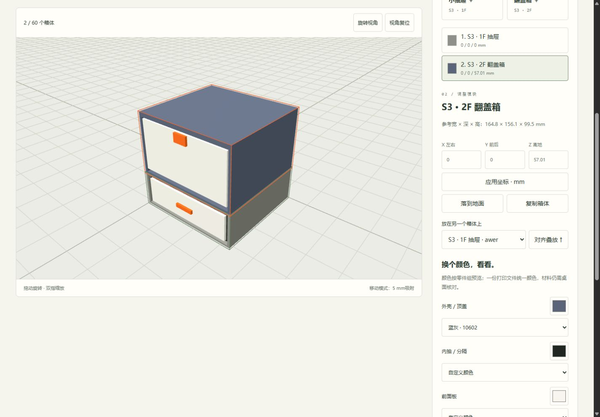
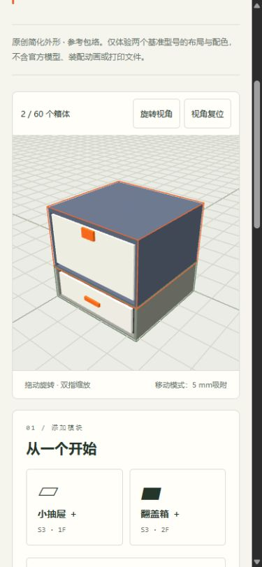

# 离线发行与手机体验验收

日期：2026-10-28。沿用已确认三期方案的第三期；不新增装配定位家族。

## 发行内容

Windows x64便携包包括工作台代码、界面、使用文档、官方嵌入式Python和许可，不包含本地资料库、STL、PDF、runtime、exports、tmp、开发环境或凭据。包内Python优先于系统Python，隔离搜索路径仅含其标准库、运行环境目录与工作台目录。Windows PowerShell启动脚本带UTF-8 BOM，Python显式使用UTF-8模式。

官方CPython 3.14.10下载及SHA-256已核对，固定于 `scripts/build_release.py`，来源与许可见[第三方资源](../THIRD_PARTY_NOTICES.md)。下载的原始ZIP仅用于本机构建，运行环境以Release附件分发，不提交到源码仓库。

```powershell
python scripts/build_release.py --python-zip tmp/python-embed/python-3.14.10-embed-amd64.zip
```

生成 `dist/VAULT-Workbench-2.1.0-windows-x64.zip`、`dist/VAULT-Demo-2.1.0-static.zip` 和 `dist/SHA256SUMS.txt`。构建文件采用白名单，不从用户设置的模型库复制文件。静态演示包只包含演示、简化渲染器、色板、Three.js和许可，可部署至HTTPS子目录；不依赖后端或CDN。

## 数据与离线边界

随手搭只支持S3 1F标准单抽屉与S3 2F整盖翻盖箱。参考包络与桌面一致，尺寸并非精确装配几何。分解、弹簧、机构运动、附件和五金仍在桌面处理。选项中未激活的界面字段不进入导出的规范配置；型号、改装、内部配置不支持时明确拒绝，不静默删去有效配置。

方案沿用version:1，最多60项，重新验证编号、配置、坐标、颜色和名称。不接受导入的尺寸、标题、文件清单或源路径。浏览器保存在独立键 `vault-demo-scene-v1`，不会覆盖桌面组合方案；文件导入和本地保存均经过相同校验。桌面加载手机方案后重新解析实际文件与打印份数。

Service Worker范围仅为 `assets/demo/`，原子预缓存11项固定资源；失败不标记离线就绪，不删除已有完整同版缓存，只清理自身旧版缓存。只对清单中的GET和演示首页导航返回缓存，不截获API或用户文件。版本缓存名随资源发行更新，发布资源变更时须同步修改app.js、sw.js与测试中的缓存版本。首次HTTPS联网并缓存后方可离线使用；浏览器清理或回收网站存储后需重新联网。

## 验证

- 对修改的运行环境ZIP拒绝构建；发行文件不包含模型、PDF、个人设置或导出。
- 在中文和空格路径中解压便携包，测试时PATH仅保留包内运行环境，并设置无效PYTHONHOME/PYTHONPATH。包内Python仍以隔离模式导入工作台、提供本地health接口和随手搭HTML，测试结束关闭临时服务。没有复用系统Python。
- Node覆盖恶意尺寸/路径被丢弃、未支持配置被拒绝、NaN/无穷与越界、颜色、重复编号、数量限制、包络碰撞、悬空、完整支撑面与吸附。
- Node离线环境检查11项资源在子目录下存在并可从缓存读取，演示导航可命中首页；API不被拦截，安装失败不破坏已有缓存，其他站点缓存保留。
- 生成的手机JSON与浏览器实际下载的JSON均由桌面实际资料库重新校验，保留配置、坐标、颜色，能够通过桌面包络检查。

67项Python回归检查及4组Node检查通过（装配网格、装配控制、完整定位、随手搭/缓存）。Windows浏览器已核对添加、复制、撤销重做、删除、颜色、坐标、叠放、JSON实际下载/重新导入及刷新恢复。390/1440像素无横向溢出，选中项文字可读，控制台无错误，离线资源显示就绪；临时视口覆盖已恢复。浏览器下载的3箱体方案由本地723模型资料库重新核对通过。





## 未实测

当前为Windows桌面浏览器与390像素视口验证，不等同于真实手机。未实测真机触摸、iOS添加主屏幕和飞行模式恢复；Node离线测试用于验证缓存逻辑，不替代真机测试。便携环境已隔离验证，尚未在独立无Python电脑或所有Windows版本上运行。
